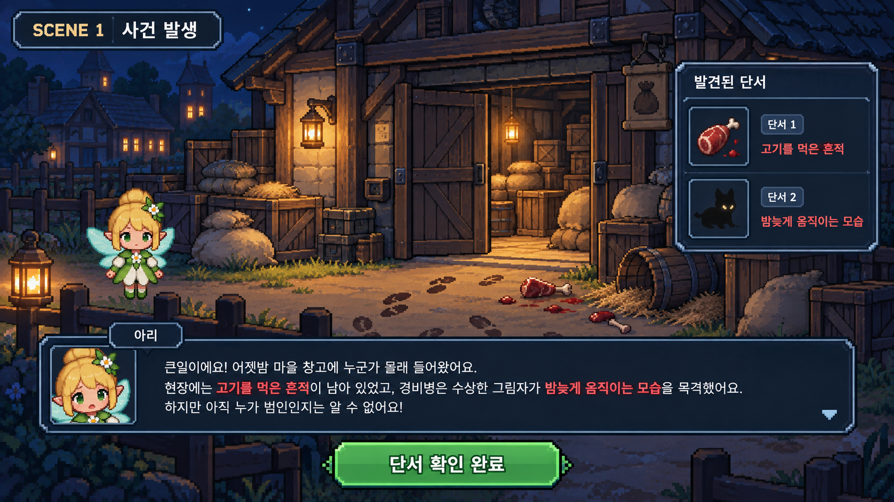
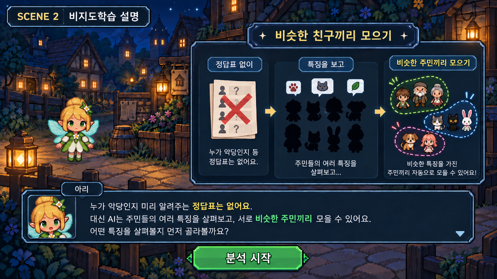
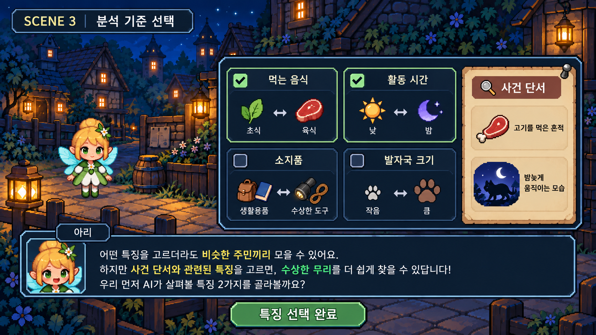
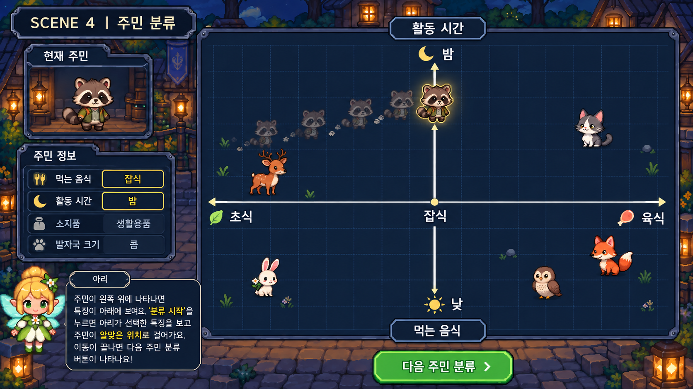
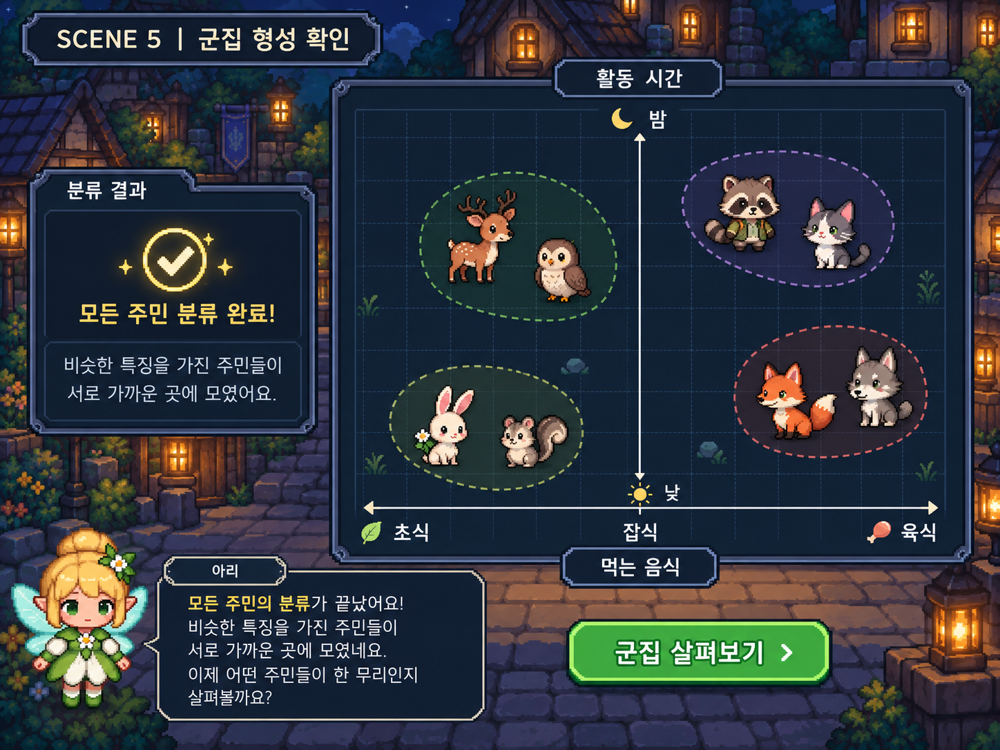
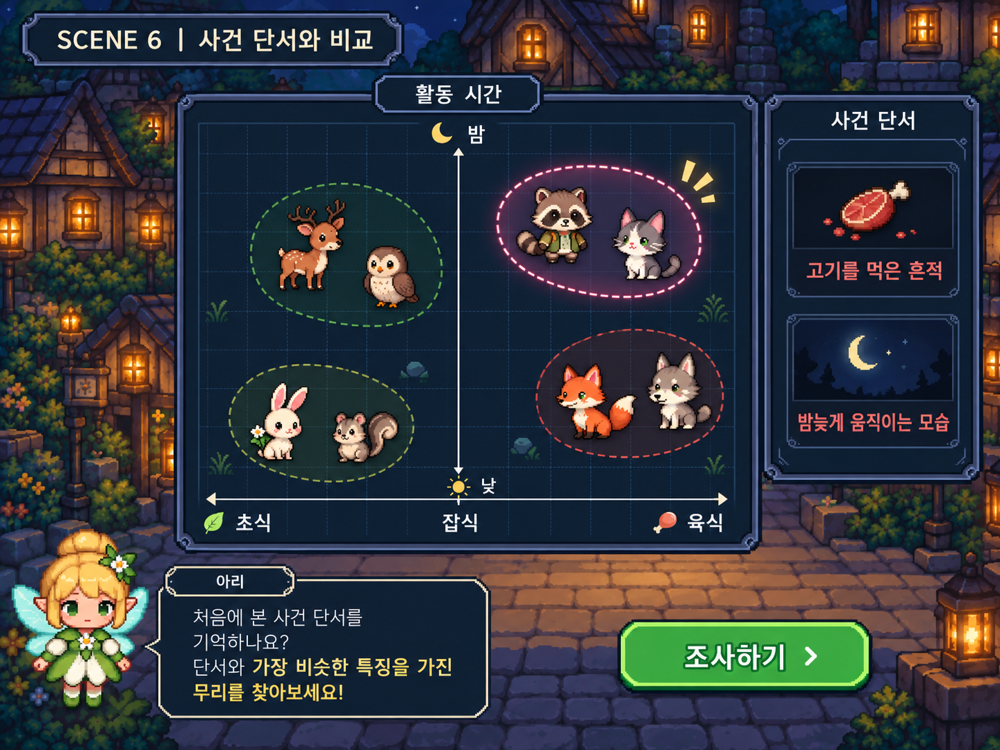
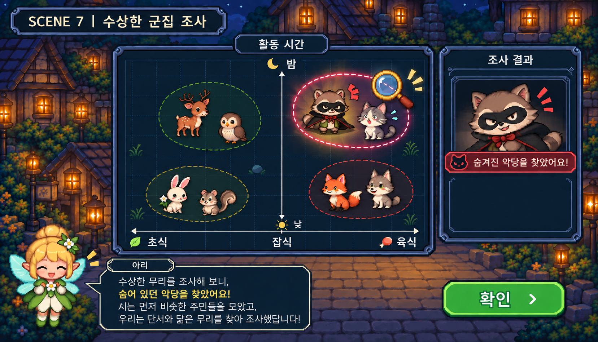
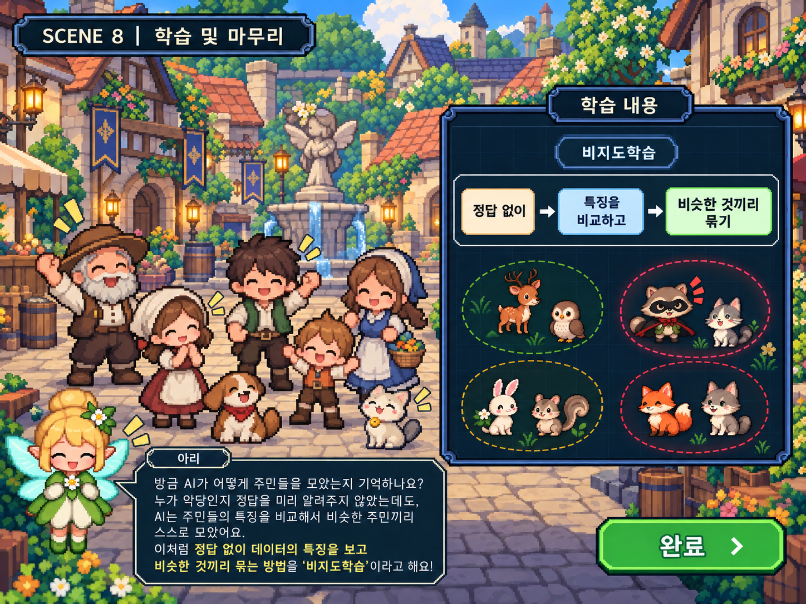

# PRD v1.0.0 | 2026-09-24 | 초안

<aside>

## 목차

1. [서비스 개요](https://app.notion.com/p/PRD-v1-0-0-2026-09-24-3e48b9dd557e80f3bafcf093e6d73db5?pvs=21)
2. [핵심 기능 명세](https://app.notion.com/p/PRD-v1-0-0-2026-09-24-3e48b9dd557e80f3bafcf093e6d73db5?pvs=21)
    
    2.1. [인공지능(AI) - AI가 무엇인지 이해하기](https://app.notion.com/p/PRD-v1-0-0-2026-09-24-3e48b9dd557e80f3bafcf093e6d73db5?pvs=21)
    
    2.2. [머신러닝 — AI가 학습하는 방법](https://app.notion.com/p/PRD-v1-0-0-2026-09-24-3e48b9dd557e80f3bafcf093e6d73db5?pvs=21) (스토리보드)
    
    2.3. 
    
</aside>

## **1. 서비스 개요**

### **1.1 서비스 한 줄 정의**

> AI 마을을 탐험하며 게이미피케이션 요소를 통해 AI의 핵심 개념을 배우고, 다양한 문제를 해결하며 AI를 이해하는 초등학생 대상 AI 학습 서비스
> 

### **1.2 문제 정의**

초등학생에게 AI는 점점 익숙한 기술이 되고 있지만, AI의 개념과 원리를 **추상적인 설명만으로 이해하기 어렵고,** 실제 생활에서 접하는 다양한 기술 중 무엇이 AI인지 구분하기도 어렵다.

또한 AI 교육이 개념이나 용어를 설명하는 방식으로 구성될 경우, 학습자가 내용을 수동적으로 받아들이는 데 그칠 수 있다.

따라서 AI의 핵심 개념을 **게임의 목표와 플레이 과정에 자연스럽게 녹여** 학습자가 직접 탐색하고 문제를 해결하면서 AI를 이해할 수 있는 교육 서비스가 필요하다.

### **1.3 서비스 목표**

초등학생이 AI를 어렵고 추상적인 기술로 받아들이는 것이 아니라, 직접 플레이하고 경험하면서 AI의 핵심 개념을 자연스럽게 이해하도록 하는 것을 목표로 한다.

### **1.4 핵심 가치 제안**

| 핵심 가치 | 내용 |
| --- | --- |
| 게임을 통한 자연스러운 학습 | 각 AI 개념을 단순한 설명이나 퀴즈가 아닌 서로 다른 게임 콘텐츠로 구성하여 학습 자체가 플레이 경험이 되도록 한다. |
| AI 개념을 단계적으로 학습 | AI를 하나의 큰 개념으로 설명하는 것이 아니라 세부 영역으로 나누어 단계적으로 학습하도록 한다. |
| 학습의 재미와 몰입 제공 | 탐험, 퀴즈 등 다양한 활동에 학습 내용을 자연스럽게 연결하여, 단순히 설명을 읽는 방식이 아닌 직접 경험하고 참여하며 AI를 학습할 수 있도록 한다. |

### **1.5 서비스 기본 구성**

| 항목 | 내용 |
| --- | --- |
| 서비스 유형 | 초등학생 대상 AI 교육 모바일 서비스 |
| 플랫폼 | 웹 |
| 타겟 사용자 | AI를 처음 접하거나 AI에 대한 기초적인 이해가 필요한 초등학생 |
| 핵심 컨셉 | AI 마을을 탐험하며 배우는 AI 학습 |
| 학습 방식 | 게이미피케이션 기반 체험형 학습 |
| 주요 콘텐츠 | AI 관련 6개 카테고리 |
| 월드맵 | AI 마을 |
| 플레이 방식 | 카테고리별로 서로 다른 게임 방식 적용 |

### **1.6 월드맵 구조**

- 서비스 시작 시 사용자는 AI 마을을 배경으로 한 월드맵을 마주한다.
- 마을에는 AI 학습을 위한 6개의 카테고리가 존재하며, 사용자가 원하는 카테고리를 선택하여 해당 콘텐츠를 플레이할 수 있다.
- 각 카테고리는 학습하는 개념에 적합한 서로 다른 게임 플레이 방식으로 설계한다.

#### 학습 카테고리

- **인공지능(AI)** — AI가 무엇인지 이해하기
- **머신러닝** — AI가 학습하는 방법
- **딥러닝** — 여러 층의 신경망으로 데이터의 특징을 학습하는 방법
- **자연어 처리(어텐션 & 트랜스포머)** — AI가 글과 말을 이해하는 방법
- **컴퓨터 비전** — AI가 이미지와 영상을 이해하는 방법
- **생성형 AI** — AI가 새로운 정보와 콘텐츠를 만들어내는 방법

## **2. 핵심 기능 명세**

### **2.1 인공지능(AI) -** AI가 무엇인지 이해하기

#### 2.1.1 제목

제목: AI의 비밀을 밝혀라!

부제목: 인공지능(AI) | AI가 무엇인지 이해하기

#### 2.1.2 핵심 학습 목표

기계와 AI의 차이를 학습자가 명확히 구분할 수 있도록 한다.

#### 2.1.3 플레이 구조

| 항목 | 내용 |
| --- | --- |
| 맵 형태 |   • 어두운 제어실 건물 내부
  • 정해진 길이 한 갈래로 연결된 형태
  • 맵 곳곳에 AI의 특징을 이해할 수 있는 6개의 쪽지가 배치됨 |
| 이동 방법 |   • 사용자가 정해진 길을 따라 직접 이동하며 탐색할 수 있도록 함
  • 물불게임과 유사한 방식 |
| 시야 | 전체 맵은 어둡게 실루엣만 보이며, 플레이어 주변의 좁은 범위만 밝게 보임 |
| 목적 | 맵 곳곳에 숨겨진 AI 특징 카드 6개를 모두 찾아 AI가 무엇인지 학습한다. |
| 카드 획득 | 카드 발견 → 터치하여 획득 → AI 특징에 대한 짧은 설명 확인 |
| 최종 단계 | 6개 카드를 모두 찾아 아리가 있는 곳에 도착하면, 아리가 AI 문제 3개를 출제 |
| 결론 | 문제 풀이 후, 정답 시 6개의 특징을 다시 정리하며 AI와 단순한 기계를 구별할 수 있도록 복기하며 마무리 |

#### 2.1.4 카드 및 퀴즈

#### AI 특징 카드 6개

각각의 AI 특징 카드는 맵에  **쪽지 형태**로 놓여 있다.

- 데이터를 학습해요 | AI는 사람이 하나하나 규칙을 알려주지 않아도, 많은 데이터를 보면서 필요한 정보를 배울 수 있어요.
- 패턴을 찾아요 | AI는 여러 데이터를 살펴보면서 반복해서 나타나는 공통점이나 규칙을 찾아낼 수 있어요.
- 스스로 판단해요 | 학습한 내용을 바탕으로 새로운 상황을 살펴보고, 알맞은 답이나 행동을 판단할 수 있어요.
- 예측할 수 있어요 | 학습한 내용을 바탕으로 앞으로 어떤 결과가 나올지 예상할 수 있어요.
- 새로운 데이터를 활용해요 | 처음 보는 데이터라도 배운 내용을 이용해 이해하거나 알맞게 판단할 수 있어요.
- 여러 종류의 데이터를 활용해요 | AI는 글, 이미지, 소리, 숫자 등 다양한 형태의 데이터를 학습하고 활용할 수 있어요.

#### 최종 퀴즈 3개

<aside>

**퀴즈 1)**

버튼을 누르면 정해진 시간 동안 작동하고, 시간이 지나면 자동으로 꺼지는 전등이 있어요. 

이 전등은 AI일까요?

**① O ② X** 
정답: **X**

**해설:**

정해진 규칙에 따라 자동으로 작동하는 것만으로는 AI라고 할 수 없어요. AI는 데이터를 학습하고 그 내용을 바탕으로 판단하거나 예측할 수 있어요.

</aside>

<aside>

**퀴즈 2)**

AI에게 강아지와 고양이 사진을 여러 장 보여주었어요.

AI는 사진에서 반복되는 특징을 학습한 뒤, 처음 보는 사진이 강아지인지 고양이인지 판단했어요.

이것은 AI를 사용한 사례일까요?

**① O ② X** 
정답: **O**

**해설:**

많은 데이터를 학습하고, 그 안에서 특징과 패턴을 찾아 새로운 데이터를 판단했기 때문에 AI를 사용한 사례예요.

</aside>

<aside>

**퀴즈 3)**

다음 중 AI를 사용하고 있는 것은 무엇일까요?

① **엘리베이터**가 버튼을 누른 층으로 이동한다.

② **로봇청소기**가 정해진 시간에 작동하여 집 안을 청소한다.

③ **스피커**가 사람의 말을 듣고 질문의 내용을 파악하여 알맞은 답을 한다.

정답: ③

**해설:**

①과 ②는 미리 정해진 규칙에 따라 작동할 수 있지만, ③은 사람의 말을 분석하고 학습한 내용을 바탕으로 질문의 의미를 파악하여 답을 만들어내므로 AI를 활용한 사례이다.

</aside>

#### 2.1.5 핵심 흐름

1. **제어실 입장**

사용자가 해당 카테고리에 진입 시 아리가 등장한다. (사용자를 수상하게 여기며 경계한다.)

> 
> 
> 
> <aside>
> 
> **아리:** 
> 
> "누구야? 여기에 들어오면 안 되는데!"
> 
> "잠깐... 네가 AI에 대해 알고 있다는 걸 증명하면 보내줄게."
> 
> “6개의 쪽지를 찾아서 AI가 무엇인지 학습한 다음, 마지막에 내가 내는 퀴즈 3개를 맞혀야 해.”
> 
> </aside>
> 
1. **제어실 탐색**

제어실 곳곳에서 AI와 관련된 6개의 쪽지를 찾는다.

1. **쪽지 획득**

각각의 쪽지를 발견하면 터치하여 해당 쪽지와 연결된 AI 학습 내용을 보여준다.

1. **6개 쪽지 획득 후 아리에게 도착**
2. **최종 퀴즈 3개**
3. 모두 정답 시 - 아리의 경계 해제 + 불이 켜짐 + 카테고리 클리어 / 오답 시 - 힌트 등장 및 하트(목숨) 차감*하트 3개 소실 시 처음부터 재시작된다.
*하트(목숨)은 최종 퀴즈 수행 시점에만 생긴다.
4. **최종 결말**

아리가 인공지능(AI)에 대해 짧게 설명한다.

### **2.2** 머신러닝 - AI가 학습하는 방법 | 비지도학습

#### 2.2.1 제목

제목: 수상한 무리를 찾아라!

부제목: 머신러닝(비지도학습) - AI가 학습하는 방법

#### 2.2.2 핵심 학습 목표

- 비지도학습은 ‘악당’, ‘주민’이라는 정답을 AI에게 미리 알려주지 않아도, 입력된 데이터의 특징을 비교하여 비슷한 데이터끼리 스스로 군집화한다는 점을 이해한다.
- 어떤 데이터를 기준으로 보느냐에 따라 군집의 모습도 달라질 수 있음을 이해한다.

#### 2.2.3 스토리보드

#### Scene 1. 사건 발생

#### 화면 구성

- 어두워진 마을 전경
- 창고 주변에 흩어진 물건과 수상한 흔적
- 아리의 사건 설명 팝업
- 단서 정리 표지판/안내문
- [단서 확인 완료] 버튼

**안내 문구**

“큰일이에요! 어젯밤 마을 창고에 누군가 몰래 들어왔어요.”

“현장에는 **고기를 먹은 흔적**이 남아 있었고, 경비병은 수상한 그림자가 **밤늦게 움직이는 모습**을 목격했어요.”

“하지만 아직 누가 범인인지는 알 수 없어요!”

※ 핵심 단서인 **고기를 먹은 흔적**, **밤늦게 움직이는 모습**은 빨간색으로 강조

---

**Scene 2. 아리의 비지도학습 설명**

#### 화면 구성

- 주민 여러 명의 실루엣
- 주민들에게 아직 ‘주민/악당’ 표시가 없음

#### 안내 문구

“누가 악당인지 미리 알려주는 정답표는 없어요.”

“대신 AI는 주민들의 여러 특징을 살펴보고, 서로 비슷한 주민끼리 모을 수 있어요.”

“어떤 특징을 살펴볼지 먼저 골라볼까요?”

---

**Scene 3. 분석 기준 선택**

#### 화면 구성

- 사건 단서 창 계속 노출
- 중앙에 4개의 특징 카드 배치
    - 먹는 음식 (초식 ↔ 육식)
    - 활동 시간 (낮 ↔ 밤)
    - 소지품 (생활용품 ↔ 수상한 도구)
    - 발자국 크기 (작음 ↔ 큼)

#### 안내 문구

“AI가 주민들을 비교할 특징 2개를 선택해 주세요.”

#### 다른 기준을 선택했을 경우

AI 분석 자체는 정상적으로 진행된다.

예: “주민들이 비슷한 특징끼리 잘 모였어요. 그런데 이 특징들로 사건 단서와 비교할 수 있을까요?”

→ 다시 특징을 선택할 수 있도록 유도

---

**Scene 4. 주민 데이터 등장 및 AI 군집화**

#### 화면 구성

- 주민 캐릭터들이 순서대로 등장
- 주민 특징 카드
    - 예시: 토끼 주민
        
        먹는 음식: 풀
        
        활동 시간: 낮
        
        소지품: 장바구니
        
        발자국: 작음
        
- 좌표평면 영역
- [분류 시작] 버튼
- [다음 주민 분류] 버튼 (이동 완료 시)

#### 안내 문구

“주민의 특징을 확인한 뒤 [분류 시작]을 눌러보세요. AI가 선택한 특징을 보고 주민을 알맞은 위치로 이동시켜요. 비슷한 특징을 가진 주민들은 자연스럽게 가까운 곳에 모이게 돼요!”

#### 인터랙션

- 주민을 직접 이동시키거나 분류하지는 않음
- [분류 시작] 버튼 클릭 시 주민 분류
- [다음 주민 분류] 버튼 클릭 시 다음 주민 분류

---

**Scene 5. 군집 형성 확인**

#### 화면 구성

- Scene 4에서 분류된 주민들이 좌표평면 위에 모두 배치된 상태
- 비슷한 위치에 있는 주민들 주변에 테두리로 영역 표시

#### 안내 문구

“모든 주민의 분류가 끝났어요! 비슷한 특징을 가진 주민들이 서로 가까운 곳에 모였네요.”

#### 인터랙션

- 각 군집 클릭 → 특징 확인 가능

---

**Scene 6. 사건 단서와 비교**

#### 화면 구성

- 좌표평면과 군집 유지
- 사건 단서 카드 다시 표시

#### 안내 문구

“처음에 발견한 사건 단서를 기억하나요? 단서와 가장 비슷한 특징을 가진 무리를 찾아보세요. 어떤 무리가 범인일까요?”

#### 인터랙션

- 군집 중 하나 선택
- [조사하기] 버튼 클릭

---

**Scene 7. 수상한 군집 조사**

#### 화면 구성

- AI 보안관이 해당 군집을 조사하는 연출
- 군집 안에서 악당 캐릭터가 정체를 드러냄

#### 안내 문구

“사건 단서와 가장 비슷한 무리를 조사했더니, 숨어 있던 악당 무리를 찾았어요!”

or

“찾았어요! 이 무리는 사건 단서와 가장 비슷한 특징을 가지고 있었고, 조사해 보니 악당들이었어요.

AI는 누가 악당인지 알고 있었던 게 아니라, 비슷한 특징을 가진 주민들을 먼저 모아 준 거예요.”

#### 인터랙션

- [확인] 버튼

---

**Scene 8. 학습 및 마무리**

#### 화면 구성

- 밝아진 마을
- 아리와 주민들 등장
- 학습 내용

#### 안내 문구

“방금 AI가 어떻게 주민들을 모았는지 기억하나요?”

“누가 악당인지 정답을 미리 알려주지 않았는데도, AI는 주민들의 특징을 비교해서 비슷한 주민끼리 스스로 모았어요. 이처럼 정답 없이 데이터의 특징을 보고 비슷한 것끼리 묶는 방법을 ‘비지도학습’이라고 해요!”

---